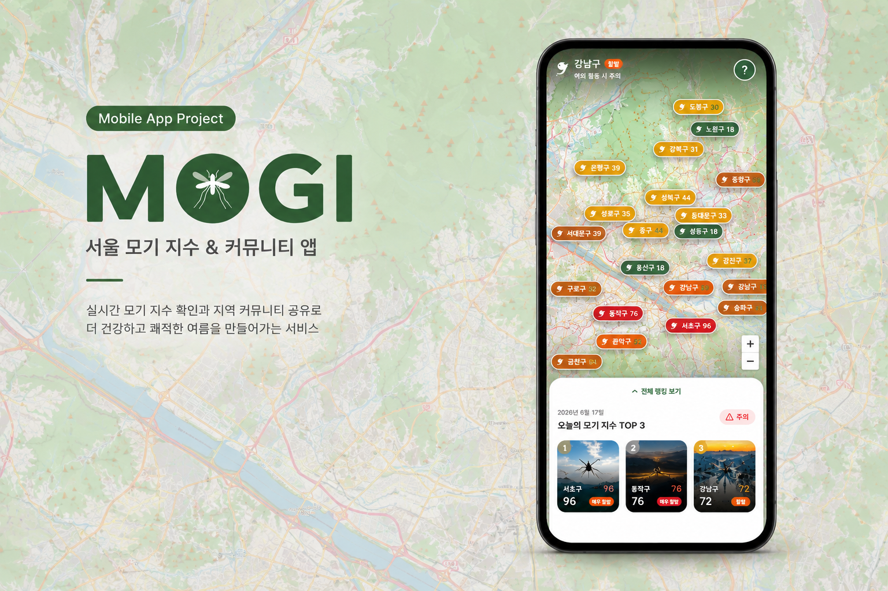

# 강민구 | Android Developer

안녕하세요. 사용자가 자연스럽게 사용할 수 있는 모바일 화면과 기능을 만드는 과정을 좋아합니다.

Kotlin과 Jetpack Compose를 중심으로 Android 개발을 공부하고 있습니다. 팀 프로젝트와 개인 개발을 통해 화면 구성, REST API 연동, 로컬 데이터 관리와 모바일 기능을 익히고 있습니다.

아직 배우는 단계에 있지만, 새로운 기술을 작은 기능부터 직접 구현하고 기록하며 제 것으로 만들어가고 있습니다.

---

## Selected Work

### 01. 오늘두 | Android 팀 프로젝트

  

CameraX와 알림 기능을 활용한 Android 애플리케이션 프로젝트입니다.

- **구현 범위:** Jetpack Compose 기반 UI와 CameraX, 서버 API, 알림 기능을 다룬 프로젝트입니다.
- **협업 방식:** GitHub, Notion, Discord와 Figma를 활용했습니다.
- **현재 상태:** 팀 프로젝트를 완료했습니다.

`Kotlin` `Jetpack Compose` `CameraX` `Coroutines` `Retrofit` `FCM`

---

### 02. mogiMap | 서울 모기 지수 서비스

  

서울의 모기 지수 정보를 제공하는 Android 팀 프로젝트입니다.

- **구현 범위:** Jetpack Compose 기반 UI와 Retrofit, DataStore를 다룬 프로젝트입니다.
- **협업 방식:** GitHub, Notion, Discord와 Figma를 활용했습니다.
- **현재 상태:** 팀 프로젝트를 완료했습니다.

`Kotlin` `Jetpack Compose` `DataStore` `Retrofit`

---

### 03. MovieLog | 영화 감상 기록 서비스

영화 감상 기록을 관리하는 Flutter 애플리케이션과 Java 백엔드 프로젝트입니다.

- **구현 범위:** Flutter와 Dart 기반 모바일 앱, Java 기반 백엔드로 구성했습니다.
- **현재 상태:** 앱과 백엔드 저장소를 공개하고 개발을 이어가고 있습니다.

`Flutter` `Dart` `Java`

[App Repository](https://github.com/rkdalsrna/movielog) · [Backend Repository](https://github.com/rkdalsrna/movielog-backend)

---

## Team Experience

### UMC

- **UMC 10기 가천대학교 Android** · 2026.03–2026.08
- **UMC 11기 가천대학교 Mobile** · 2026.09–

팀 단위 모바일 프로젝트를 진행하며 GitHub 기반 협업과 Android 개발 경험을 쌓고 있습니다.

---

## 개발하는 방식

| 단계 | 중요하게 생각하는 것 |
|:---|:---|
| 이해 | 기술을 사용하기 전에 어떤 문제를 해결하는지 먼저 확인합니다. |
| 구현 | 작은 기능부터 직접 실행해보며 동작 원리를 익힙니다. |
| 협업 | GitHub와 Notion으로 작업 내용과 진행 상황을 공유합니다. |
| 기록 | 해결한 문제와 새롭게 배운 내용을 다음 작업에 활용할 수 있게 남깁니다. |

---

## 사용한 기술

### Mobile

`Kotlin` `Android` `Jetpack Compose` `Flutter` `Dart`

### Development

`Java` `Python` `JavaScript` `Retrofit` `Firebase` `DataStore`

### Tools & Collaboration

`Android Studio` `Git` `GitHub` `Figma` `Postman` `Notion` `Discord`

---

## Education & Certification

- 가천대학교 컴퓨터공학과 · 2024–
- 정보처리기사 · 2026.08
